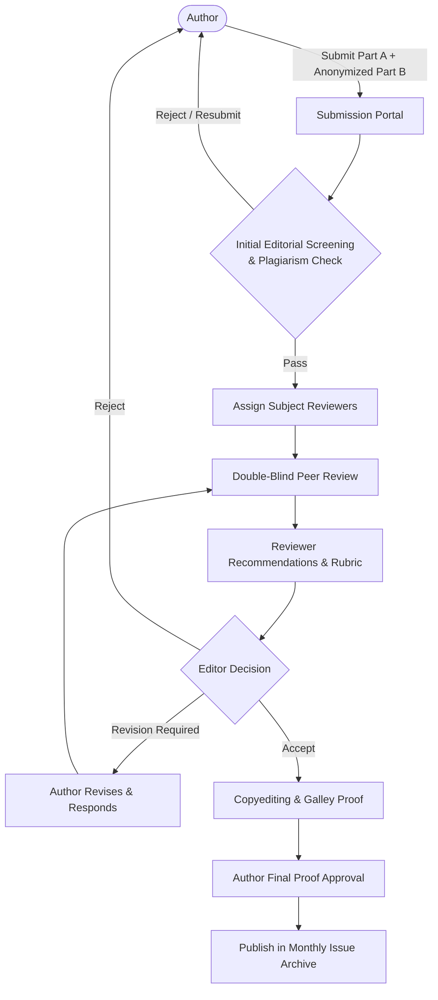

# Project Requirements & Specification: Zankhana International E-Journal

## 1. Executive Summary & Project Identity

This project is a comprehensive, modern academic publishing web platform and editorial management system built for **Zankhana International E-Journal**, published by **Madhav Publication**.

The system enables scholars, researchers, educators, and students from across India and worldwide to submit, review, publish, and access scholarly research articles across diverse academic disciplines.

### Key Journal Identifiers & Information:
- **Journal Title:** Zankhana International E-Journal
- **ISSN:** 2350-0271
- **Official Domain / Website:** `https://zankhana.org`
- **Publisher:** Madhav Publication
- **Publisher Address:** "Manas", Panch Pada, Shivaji Nagar, Botad, Gujarat, India
- **Official Contact Email:** `zankhanaejournal@gmail.com`
- **Publication Frequency:** Monthly (12 issues per calendar year)
- **Publication Format:** Online open-access electronic journal (e-Journal)
- **Peer-Review Model:** Structured Double-Blind Peer Review
- **Supported Languages:** Multilingual publishing in **English**, **Hindi (हिन्दी)**, **Gujarati (ગુજરાતી)**, and **Sanskrit (संस्कृतम्)**

---

## 2. Vision, Mission & Scope

### 2.1 Vision
To establish Zankhana International E-Journal as a credible, inclusive, and academically rigorous platform for disseminating high-quality scholarly research and innovative ideas across multiple disciplines, promoting research culture, interdisciplinary collaboration, and the advancement of knowledge, education, and societal progress.

### 2.2 Mission
- Provide an accessible, transparent, and academically responsible platform with ethical peer-review procedures.
- Foster critical thinking, evidence-based inquiry, and academic integrity.
- Support knowledge dissemination in English, Hindi, Gujarati, and Sanskrit.
- Uphold strict publication ethics, originality, and responsible authorship.

### 2.3 Multidisciplinary Disciplines Covered
The portal caters to diverse fields including, but not limited to:
- Education & Teacher Education
- Arts & Humanities (Literature, History, Philosophy, Languages)
- Commerce, Banking & Finance
- Science & Information Technology
- Social Sciences (Sociology, Psychology, Economics, Political Science, Public Administration, Geography, Law)
- Business Management & Corporate Studies
- Physical Education, Sports Science & Library Science
- Interdisciplinary and Multidisciplinary Studies

### 2.4 Accepted Types of Manuscripts
1. **Original Research Papers** (Empirical & theoretical research)
2. **Review Articles & Systematic Literature Reviews**
3. **Conceptual Papers & Theoretical Frameworks**
4. **Analytical Studies & Models**
5. **Case Studies**
6. **Technical Notes & Simulation Studies**
7. **Book Reviews**
8. **Theme-based Scholarly Contributions**

---

## 3. Platform Architecture & Functional Requirements

The platform consists of two primary operational areas:
1. **Public Scholarly Web Portal** (Reader & visitor facing)
2. **Journal Editorial & Submission Management System** (Author, Reviewer, Editor, and Admin portal)

```
+-----------------------------------------------------------------------------------+
|                        Zankhana INTERNATIONAL E-JOURNAL                           |
+-----------------------------------------------------------------------------------+
|  [Public Portal]                                                                  |
|   - Home / Announcements           - Current Issue & Archive (PDF Reader/Download)|
|   - About the Journal / Publisher  - Search & Filter (Title, Author, Subject)     |
|   - Guidelines & Templates         - Policies (Ethics, Plagiarism, Copyright)     |
|   - Contact & Inquiries            - Multilingual Typography & Presentation       |
+-----------------------------------------------------------------------------------+
|  [Editorial & Submission Management System]                                       |
|   - Author Portal: Submission (Part A + Part B), Tracking, Revisions, Proofs     |
|   - Peer-Review Portal: Double-blind assignments, structured scoring, feedback    |
|   - Editorial Office: Screening, similarity check, decisions, volume management   |
|   - Admin Dashboard: Content CMS, user roles, issue publishing, archiving         |
+-----------------------------------------------------------------------------------+
```

---

## 4. Public Web Portal: Pages & Content Specifications

Based on the core source documents in `private/text`, the public website must include the following dedicated sections and pages:

### 4.1 Home Page (`home.txt`)
- **Hero & Welcome Section:** Prominent introduction to Zankhana International E-Journal with ISSN: 2350-0271.
- **Highlights:** Monthly publication frequency, peer-reviewed nature, open access model, and multilingual coverage.
- **Call-to-Action (CTA):** "Submit Manuscript", "Current Issue", "Browse Archive", "Author Guidelines".
- **Current Issue Showcase:** Display volume, issue number, publication date, cover image, table of contents with direct PDF download buttons.
- **Recent Announcements / Call for Papers:** Updates for upcoming monthly issues and submission deadlines.

### 4.2 About Us (`About Zankhana International E-Journal.txt`)
- Detailed Journal Profile, Vision, and Mission statements.
- Publisher information: Madhav Publication, Botad, Gujarat.
- Scope and disciplines covered.
- Commitment to academic integrity, transparency, and collaborative scholarship.

### 4.3 Frequency of Publication (`FREQUENCY OF PUBLICATION.txt`)
- Clear statement of publication frequency: **Monthly (12 issues per year)**.
- Publication format: **Online Mode**.
- Regularity schedule and monthly release criteria.

### 4.4 Author Guidelines (`AUTHOR GUIDELINES.txt`)
Detailed guide instructing prospective authors on:
- Scope and accepted manuscript categories.
- Originality, exclusivity, and prior disclosure requirements (preprints/conferences).
- Manuscript formatting checklist (Microsoft Word `.docx`, margin 0.5", 1.5 line spacing, APA 7 reference style).
- **Language & Font Specifications:**
  - **English:** Times New Roman (Title: 14pt Bold, Subtitles/Body: 12pt).
  - **Gujarati:** LMG or Tera Font (Title: 14pt Bold, Subtitles/Body: 12pt).
  - **Hindi:** Mangal or Krutidev Font (Title: 14pt Bold, Subtitles/Body: 12pt).
  - **Sanskrit:** Mangal Font (Title: 14pt Bold, Subtitles/Body: 12pt).
- Double-blind preparation requirements (separation of Part A and Part B).
- Research ethics declarations, human/animal consent, conflicts of interest.
- Responsible use of Generative AI (disclosure required, AI cannot be listed as author).
- Article Processing Charges (APC) transparency statement.

### 4.5 Manuscript Templates & Downloads (`MANUSCRIPT TEMPLATE Part A.txt`, `Part B.txt`)
Directly downloadable template files (`.docx` / `.pdf`):
1. **Part A: Title Page & Author Declaration:**
   - Manuscript Title & Article Type.
   - Author & Co-Author details (Full Name, Designation, College/Institution, City/State/Country, Email, ORCID).
   - Funding statement & Conflict of Interest disclosure.
   - Acknowledgements & Ethics/Consent approval reference.
   - AI Tool Use Disclosure.
   - Signed / Agreed Author Declaration Checklist (Originality, Exclusive Submission, Co-Author approval, Accurate reporting, Copyright compliance).
2. **Part B: Main Manuscript (Anonymized for Double-Blind Review):**
   - Title (concise, specific).
   - Abstract (Structured: Background/Objective, Methodology, Key Findings, Conclusion).
   - Keywords (4–6 separated by semicolons).
   - Introduction & Literature Review.
   - Objectives / Research Questions / Hypotheses.
   - Methodology (Design, Population/Sample, Tools/Materials, Data Collection, Analysis, Ethics).
   - Results & Findings (with numbered, titled Tables and Figures).
   - Discussion & Implications.
   - Conclusion & Recommendations.
   - References (APA 7th Edition format).

### 4.6 Peer Review Process (`PEER REVIEW PROCESS.txt`)
A transparent, 8-stage peer review roadmap explained visually:
- **Stage 1: Manuscript Submission** (Via online submission facility).
- **Stage 2: Initial Editorial Screening** (Scope, formatting, relevance).
- **Stage 3: Plagiarism & Research Integrity Screening** (Similarity checking).
- **Stage 4: Reviewer Selection** (Expert matching, conflict of interest checks).
- **Stage 5: Double-Blind Peer Review** (Constructive review on originality, methodology, clarity, rigor).
- **Stage 6: Editorial Decision** (Accept, Minor Revision, Major Revision, or Reject).
- **Stage 7: Author Revision** (Point-by-point response to reviewer feedback within specified deadlines).
- **Stage 8: Final Acceptance, Proofreading & Production** (Copyediting, reference check, galley proof review, online issue release).
- Detailed policies on Confidentiality, Editorial Independence, and Appeals & Complaints.

### 4.7 Publication Ethics Policy (`PUBLICATION ETHICS.txt`)
- Guidelines for Authors, Editors, and Reviewers.
- Standards against fabrication, falsification, and unethical manipulation.
- Clear authorship criteria and co-author approval requirements.
- Conflict of interest management.
- Post-publication corrections, clarifications, and retractions.
- Transparent mechanism for complaints and academic appeals.

### 4.8 Plagiarism Policy (`Plagiarism Policy.txt`)
- Absolute zero-tolerance for intentional plagiarism, duplicate publication, and improper attribution.
- Digital screening tools used during editorial triage.
- Holistic editorial review of similarity reports (evaluating context rather than arbitrary numbers alone).
- Actions taken upon violation (revision request, immediate rejection, or post-publication retraction).

### 4.9 Copyright & Open Access Policy (`COPYRIGHT POLICY.txt`)
- **Copyright Ownership:** Retained by the respective author(s).
- **Open Access License:** Free, open dissemination for education, teaching, and research.
- **Publisher Rights:** Non-exclusive publication and distribution rights granted to Madhav Publication / Zankhana International E-Journal.
- **Third-Party Permissions:** Authors' responsibility for reproducing copyrighted figures/data.
- Website branding, design, and logo protection.

### 4.10 Current Issue & Archive Pages
- **Current Issue:** Live view of the latest active monthly volume and issue.
- **Archives:** Filterable by Year, Volume, and Issue Number (12 issues per year).
- **Article Details View:**
  - Title, Authors, Affiliation, ORCID, DOI/ISSN (2350-0271), Publication Date, Language.
  - Full Abstract and Keywords.
  - Full PDF Viewer and Direct Download link.
  - Citation export tool (APA, MLA, Chicago, BibTeX).

### 4.11 Contact Us Page (`CONTECT US.txt`)
- Publisher Name: **Madhav Publication**
- Address: **"Manas", Panch Pada, Shivaji Nagar, Botad, Gujarat, India**
- Email: **`zankhanaejournal@gmail.com`**
- Interactive Contact/Inquiry Form (Name, Email, Subject, Message, Captcha).

---

## 5. User Roles, Workflows & Editorial System

To function as a complete e-Journal platform, the project requires an integrated role-based editorial management workflow:



### 5.1 Author Features
- **User Account & Profile:** Profile management, institutional affiliation, designation, college, ORCID ID.
- **Manuscript Submission Wizard:**
  - Step 1: Article metadata (Title, Subject discipline, Language, Abstract, 4-6 Keywords).
  - Step 2: Author & Co-author details (for Part A).
  - Step 3: File uploads:
    - Part A: Title Page & Signed Author Declaration (`.docx` / `.pdf`).
    - Part B: Anonymized Manuscript (`.docx` / `.pdf`).
    - Supplementary files (datasets, ethical approvals, consent letters).
  - Step 4: Ethical confirmation checkboxes (Originality, Exclusive submission, AI disclosure, Conflict of interest).
- **Author Dashboard:**
  - Track real-time manuscript status (`Submitted`, `Under Screening`, `Under Peer Review`, `Revision Requested`, `Accepted`, `In Production`, `Published`, `Rejected`).
  - View editor and reviewer comments.
  - Submit revised files along with point-by-point author rebuttal/response.
  - Review and approve galley proofs prior to publication.

### 5.2 Reviewer Features
- Secure invitation acceptance / rejection.
- Double-blind review interface (author names and affiliations hidden).
- Structured evaluation rubric:
  - Originality & scholarly contribution.
  - Methodological soundness.
  - Literature review & referencing quality.
  - Clarity of results and conclusions.
  - Ethical standards.
- Confidential remarks to the Editor vs. constructive remarks to the Author.
- Final Recommendation: *Accept*, *Minor Revision*, *Major Revision*, or *Reject*.

### 5.3 Editor / Section Editor Features
- Central submission triage queue.
- Plagiarism similarity report logging.
- Reviewer search, invitation, and assignment.
- Editorial decision making and communication templates.
- Track revision deadlines and peer-review turnaround times.
- Galley proof management and pre-publication verification.

### 5.4 Super Admin Features
- **Content Management System (CMS):** Edit static pages (About Us, Guidelines, Ethics, Policies, Contact information).
- **Issue & Volume Management:** Create and organize monthly issues (12 per year), schedule release dates, upload volume cover art.
- **Article Publishing:** Generate article metadata, assign page numbers, generate/upload final article PDFs, toggle published status.
- **User & Role Management:** Manage Authors, Reviewers, Editors, and Administrators with granular permissions.
- **Contact Inquiries:** View and reply to visitor queries sent through the contact form.

---

## 6. Technical & System Specifications

### 6.1 Backend & Framework
- **Framework:** Laravel (v11/v12/v13 on PHP 8.2+)
- **Database:** MySQL / PostgreSQL
- **Authentication:** Laravel Breeze / Fortify / Jetstream with Role-Based Access Control (RBAC) (Admin, Editor, Reviewer, Author).
- **File Storage:** Secure storage for private documents (review copies, Part A files) vs. public storage for published PDFs and templates.

### 6.2 Frontend & UI/UX
- **Modern Academic Theme:** Clean, trustworthy, responsive (Tailwind CSS / Bootstrap).
- **Multilingual Typography Support:**
  - Proper font rendering and character encoding (UTF-8) for Gujarati (ગુજરાતી), Hindi (हिन्दी), Sanskrit (संस्कृतम्), and English.
  - Support for Indic scripts without glyph distortion.
- **PDF Viewing:** Integrated responsive PDF reader for viewing research papers directly in the browser.
- **SEO & Academic Indexing Readiness:**
  - Open Graph & Dublin Core meta tags (`DC.title`, `DC.creator`, `DC.issued`, `DC.identifier`, `citation_journal_title`, `citation_issn`, `citation_pdf_url`).
  - Google Scholar indexing compatibility.
  - XML Sitemap and structured JSON-LD data.

### 6.3 Security & Integrity
- Anonymization safeguards: Automated stripping of author metadata for double-blind review copies.
- CSRF protection, file type verification (`.docx`, `.pdf`, max upload size restrictions), and input sanitization.
- Secure audit logging for editorial decisions and review status changes.

---

## 7. Immediate Next Steps / Roadmap

1. **Database Schema Design:**
   - Users & Profiles (designation, college, ORCID, role).
   - Volumes & Issues (year, volume number, issue number 1-12, publication month, status).
   - Manuscripts / Articles (title, abstract, keywords, discipline, language, status, slug, view count, download count).
   - Manuscript Files (Part A, Part B anonymized, supplementary files, galley proofs, published PDF).
   - Reviews & Reviewers (assignments, scores, comments, recommendations).
   - Editorial Logs & Communications.
2. **Static & Content Pages Implementation:**
   - Migrate and style all 12 policy and information texts into responsive Blade views.
3. **Manuscript Submission Portal:**
   - Multi-step submission form honoring Part A (author details & declaration) and Part B (anonymized paper).
4. **Editorial & Review Workflow:**
   - Editorial dashboard, double-blind review routing, and monthly issue publishing pipeline.
5. **Issue Archive & Public Reader Experience:**
   - Issue table of contents, article detail page, PDF viewer, citation generator.

